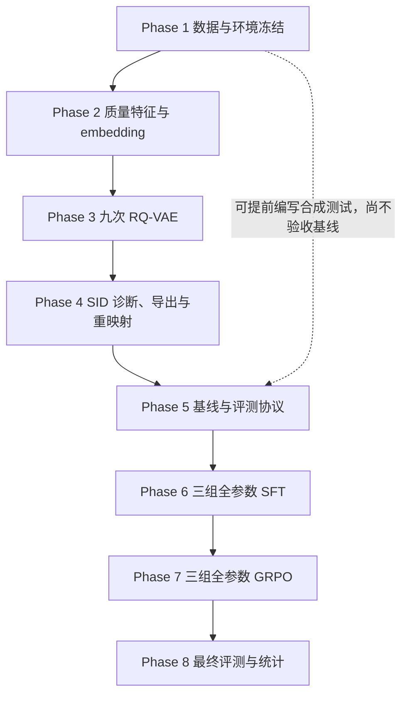

# MiniOneRec v2：分期实验主入口

> **初始状态：未开始。**本文是实验执行规划，不代表脚本已实现、训练已完成或验收已通过。  
> **研究协议来源：**[topic_minionerec_v2.md](../../topic_minionerec_v2.md)。[v1 原设计](../../topic_minionerec.md)仅供追溯。  
> **工作目录：**所有运行命令从 `project/MiniOneRec/` 执行；本文中的 `outputs/v2/` 等产物路径均相对此目录。指南目录只存说明，不存训练产物。

## 1. 目标与研究边界

研究“元数据质量如何通过语义 ID 影响推荐”，比较：

- **RQ1：**B−A，字段分离与质量融合的整体变化是否改善 SID 和推荐效果？
- **RQ2：**C−B，一致性约束是否提高语义码/邻域稳定性，同时保留有效区分能力？
- **RQ3：**三种 SID 在全参数 SFT 和 GRPO 后是否仍有差异，缺失描述目标的自然切片表现如何？

本指南把 v2 拆成八期，不改变研究矩阵。模型规模、额外数据域、额外 SID 算法和新 RL reward 不在本次范围。冻结量化器的元数据扰动诊断不是端到端推荐抗扰动测试；自然切片不是随机实验，不能作因果推断。

### A/B/C 固定定义

公共编码函数为冻结 `Qwen/Qwen3-Embedding-4B` 的 masked mean pooling，排除 padding，每次最大长度 2,048，再做 L2 归一化，记为 \(E\)。

| 方法 | 干净输入 | 训练目标 |
|---|---|---|
| A：Concat | \(E(title+description)\) | 重构损失 + 量化损失 |
| B：Quality Fusion | 独立编码标题/描述，按固定质量权重融合 | 与 A 相同 |
| C：B + Consistency | 与 B **同一份干净表示**，另有描述删除 30% 的训练视图 | 干净视图原损失 + 0.1 × 量化表示一致性 |

固定质量规则：

\[
q_i=\mathbf1[n_i>0]\min(n_i/32,1)(1-r_i),\qquad w_i=0.5q_i,
\]

\[
x_i^{B,C}=\operatorname{L2Norm}((1-w_i)E(title_i)+w_iE(description_i)).
\]

\(n_i\) 为清洗后描述按空白分词的数量；质量统计对词转小写。至少三个词时，\(r_i=1-\lvert UniqueTrigrams\rvert/(n_i-2)\)，否则为 0。空描述直接回退标题，不编码空字符串。

\[
L_C=L_{reconstruction}(clean)+L_{quantization}(clean)
+0.1\,\operatorname{mean}_{i\in V}[1-\cos(z_{q,i}^{clean},z_{q,i}^{aug})].
\]

\(z_q\) 为三层量化输出之和，两个分支保留 straight-through 梯度。无有效视图时一致性项为 0，范数下界 `1e-8`。扰动分支不额外计算重构或量化损失。

## 2. Pipeline、导航与依赖



| 期次与入口 | 交接给下一期的主要产物 | 初始状态 | 验收证据 |
|---|---|---|---|
| [Phase 1：数据与环境](phase1_dataset_prep.md) | 环境锁、输入哈希、行/任务/扰动清单 | 未开始 | 待执行生成 |
| [Phase 2：质量与表示](phase2_quality_embeddings.md) | A/B/C 干净表示、训练与诊断视图缓存 | 未开始 | 待执行生成 |
| [Phase 3：RQ-VAE](phase3_rqvae_training.md) | 九个最终 checkpoint、配置和训练日志 | 未开始 | 待执行生成 |
| [Phase 4：SID](phase4_sid_diagnostics_export.md) | 三种子诊断、seed 42 映射、共同词表、重映射 CSV | 未开始 | 待执行生成 |
| [Phase 5：基线与评测器](phase5_baselines_eval_protocol.md) | 两个冻结基线、经合成样例验证的评测/统计接口 | 未开始 | 待执行生成 |
| [Phase 6：SFT](phase6_sft_training.md) | A-SFT/B-SFT/C-SFT 最佳 validation loss checkpoint | 未开始 | 待执行生成 |
| [Phase 7：GRPO](phase7_grpo_training.md) | A-RL/B-RL/C-RL 完整两 epoch 最终 checkpoint | 未开始 | 待执行生成 |
| [Phase 8：正式统计](phase8_final_evaluation.md) | 主表、切片、区间、SID/资源表、结论 | 未开始 | 待执行生成 |

正常依赖是 1→2→3→4→5→6→7→8。上游验收未通过时不得启动依赖该产物的正式运行。Phase 5 可提前做纯合成指标测试，但正式基线必须使用冻结后的共同目录/数据协议。

## 3. 固定实验矩阵与预算

### 3.1 量化器运行登记

| 方法 | 正式运行 ID | 数量 | 下游使用 |
|---|---|---:|---|
| A | `RQ-A-42`、`RQ-A-43`、`RQ-A-44` | 3 | 仅 seed 42 |
| B | `RQ-B-42`、`RQ-B-43`、`RQ-B-44` | 3 | 仅 seed 42 |
| C | `RQ-C-42`、`RQ-C-43`、`RQ-C-44` | 3 | 仅 seed 42 |

量化器正式训练 **9 次**，每次 10,000 epochs，固定最终 checkpoint，不根据推荐指标或最小碰撞挑种子。三类扰动 `drop30/drop60/dropall` × 三方法 × 三种子，形成 **27 个冻结诊断组合**，不是新增训练。

### 3.2 推荐方法登记

| ID | 设置 | 正式训练/构建 | Phase 8 评测 |
|---|---|---|---|
| B0 | 训练目标频次 Popularity | 一份频次排序 | 是 |
| B1 | 共同序列 SASRec | 一次基线训练 | 是 |
| A-SFT | A 的 seed 42 SID | 一次全参数 SFT | 是 |
| B-SFT | B 的 seed 42 SID | 一次全参数 SFT | 是 |
| C-SFT | C 的 seed 42 SID | 一次全参数 SFT | 是 |
| A-RL | 从 A-SFT 初始化 | 一次全参数 GRPO | 是 |
| B-RL | 从 B-SFT 初始化 | 一次全参数 GRPO | 是 |
| C-RL | 从 C-SFT 初始化 | 一次全参数 GRPO | 是 |

合计 **3 次 SFT + 3 次 GRPO = 6 次正式 LLM 训练**，最终 **8 个方法**。官方 checkpoint 只作环境 sanity check；smoke、单步梯度测试、扰动推理和断点续跑不冒充新增独立正式实验。

### 3.3 数据、种子和模型

| 设置 | 固定值 |
|---|---|
| 数据 | Industrial；原始目录静态元数据共同可见 |
| 商品/缺失描述 | 3,686 / 229 |
| Train/Validation/Test 行 | 36,259 / 4,532 / 4,533 |
| Test 用户/缺失描述目标行 | 1,987 / 447 |
| 编码器 | `Qwen/Qwen3-Embedding-4B`，冻结，同一 revision |
| 推荐模型 | `Qwen/Qwen3-0.6B-Base`，同一 revision |
| RQ seeds | 42、43、44 |
| LLM、清单、Bootstrap seed | 42 |
| 训练/诊断扰动 seed | 1701 / 2701 |
| 训练视图 | 每商品固定删除约 30% 描述词，标题不变 |
| 部分删除词数 | `min(n-1,max(1,floor(p*n)))`，n<2 时无有效视图 |
| 下游 SID | 三层语义 code + 确定性第四后缀，共四 token |

### 3.4 正式训练参数

| 环节 | 固定配置 |
|---|---|
| RQ-VAE | 三层×256；量化维度 32；MLP `[2048,1024,512,256,128,64]`；MSE；quant weight=1；commitment beta=0.25 |
| RQ 优化 | AdamW，LR=`1e-3`，batch=20,480（实际目录全量），10,000 epochs，50 epoch warmup+constant；weight decay/dropout=0，BN 关闭 |
| RQ 初始化/导出 | K-means 初始化 100 iterations；Sinkhorn epsilon `[0,0,0]`；原始导出 `use_sk=False` |
| SFT | 全参数，BF16，AdamW，LR=`3e-4`，长度512，有效 batch1024，micro16×累积64，最多10 epochs |
| SFT 选模 | 相同验证频率、patience=3次验证；最低 validation SFT loss；记录实际停止步数 |
| GRPO | 全参数，BF16，`paged_adamw_32bit`，LR=`1e-5`，KL beta=`1e-3`，2 epochs |
| GRPO 分组 | G=16，单卡 train batch16×累积32=512条候选序列/更新，约32个 prompt 组 |
| GRPO 数据 | 10,000 prompt：8,000序列→SID、1,000标题→SID、1,000文本历史→SID |
| GRPO 其他 | completion上限128；原 correctness+ranking；原 constrained beam search；关闭 dynamic sampling/DAPO/GSPO |
| 参考模型 | 完整无梯度副本，`sync_ref_model=True`；从锁定版本导出实际同步间隔/混合系数，三组一致 |
| 正式 RL checkpoint | 完整两 epoch 的最终 checkpoint，不从测试结果挑选 |

A→B 整体改变字段编码和融合；B→C 增加一致性项及计算。相同训练上限和规则不等于相同实际 FLOPs；按实际资源报告。

## 4. 共同评测与测试集使用

- **Phase 8 前不得生成或查看正式 test 推荐指标。**可以审计 test 行数/身份，不可据其表现选模型、参数或停止点。开发用训练子集与 validation；官方 checkpoint sanity check 也用 validation。
- 正式生成统一 Beam=50、返回50候选、合法 SID 路径、`length_penalty=0`；强制 `do_sample=False/top_k=None/top_p=None/temperature=1.0`。
- 候选还原为原 item ID，在同一目录上排序；各方法均不屏蔽历史商品，允许重复购买。
- 非法候选保留排名占位，重复候选按首次出现计命中；不能删除后向前补位。正式生成式模型非法率必须为0。
- 主指标 NDCG@10；补充 HR/NDCG@3/5/10、Coverage@10、非法率、重复率与资源。主表按行平均，另报用户内先平均的用户宏平均。
- 目标商品原始描述缺失/非缺失切片报告行数、用户数、指标和区间；标签不随清洗或方法变更。
- 2,000 次配对用户聚类 Bootstrap，seed42；每轮抽取1,987个用户簇，保留每个被抽中用户的全部行和重复次数。各方法共享抽样，计算行加权差值的2.5%/97.5%分位区间。
- 比较 SFT 阶段及 RL 阶段各自的 B−A、C−B、C−A，以及 A/B/C 各自 RL−SFT。Bootstrap 不代替多种子 LLM 训练。
- 冻结量化器诊断只用消歧前的前三层；前缀只能同一运行内比较；NPR@10 的候选参考固定为该运行的干净量化目录，排除自身。

## 5. 产物路径与入口状态

未来执行时采用以下路径；**本次不创建任何结果文件**：

```text
outputs/v2/
  environment/environment_lock.json
  manifests/                 # 文件哈希、原始行、质量、任务、扰动清单
  embeddings/{A,B,C}/        # item_ids、clean、aug、valid_aug、metadata
  rqvae/{A,B,C}/seed_{42,43,44}/final_checkpoint.pth
  sid/                      # 原始码、诊断原始值和导出记录
  data/{A,B,C}/             # 各组CSV、index、item、info
  tokenizer/                # 共同词表、各组绑定记录
  baselines/{B0,B1}/
  checkpoints/{A,B,C}-SFT/
  checkpoints/{A,B,C}-RL/
  predictions/              # 逐行item-ID候选与原始生成
  results/                  # 指标、切片、差值、Bootstrap、资源表
  evidence/phase{1,2,3,4,5,6,7,8}/
  logs/                     # 按phase与run ID保存
  smoke/                    # 调试产物，禁止进入正式结果
```

| 入口 | 当前性质 | 分期责任 |
|---|---|---|
| `rq/text2emb/amazon_text2emb.py` | 既有实现；需适配字段缓存、显式ID与融合 | Phase 2 |
| `rq/rqvae.py`、`rq/models/rqvae.py` | 既有实现；需适配seed、成对视图与最终checkpoint | Phase 3 |
| `scripts/v2_prepare.py` | 待新增接口 | Phase 1 |
| `scripts/v2_build_embeddings.py` | 待新增接口 | Phase 2 |
| `scripts/v2_train_rqvae.py` | 待新增接口 | Phase 3 |
| `scripts/v2_export_sid.py` | 待新增接口 | Phase 4 |
| `sasrec.py` | 既有基线；需适配共同数据、选模和结果接口 | Phase 5 |
| `sft.py` | 既有入口；需共同词表、完整四token和任务适配 | Phase 6 |
| `scripts/v2_train_grpo.py` | 待新增入口，复用原 ReReTrainer/reward | Phase 7 |
| `evaluate.py` | 既有入口；需生成配置、row_id和结果适配 | Phase 5/8 |
| `scripts/v2_evaluate.py` | 待新增评测统计接口，Phase 5验证后Phase 8正式使用 | Phase 5/8 |

本指南中的拟新增命令是接口规格，不代表当前可执行；不可把未来参数直接传给原脚本。以实际实现后的 help、锁定配置和测试证据完成阶段验收。

## 6. 验收、记录与恢复

### 6.1 推进决策

| 决策 | 含义 | 后续 |
|---|---|---|
| 通过，可推进 | 技术检查通过、产物和证据齐全 | 交接并进入下一期 |
| 通过，携带研究发现推进 | 已排除实现错误，仍出现未提升、退化或坍塌等负结果 | 保留原配置和方法，携带发现进入后续实验 |
| 阻断 | 数据错位、非有限损失、映射/分组/评测错误，或正式运行不完整 | 修复并重新验收受影响部分 |

“未开始/进行中/待验收”是过程状态，不等于通过。指标上涨、C优于B、RL提升均不是验收条件。研究发现须附排错证据；数值错误或空产物不能包装成负结果。

### 6.2 统一证据与运行记录

每期未来生成 `outputs/v2/evidence/phaseN/acceptance.md`，逐项填写条件、实测值、证据路径、文件哈希及结论；本指南的验收复选框初始全部未勾选。

| 字段 | 要求 |
|---|---|
| phase / run_id / status | 正式、smoke或resume明确标识；初始未开始 |
| code/model revision | commit加工作区差异哈希；模型revision及路径 |
| input/config hashes | 包含上游清单、checkpoint、词表和参数 |
| command / cwd | 完整命令、工作目录、开始/结束时间 |
| checkpoint / progress | 实际epoch、optimizer step、scheduler状态和产物哈希 |
| resources | GPU-hours、wall time、峰值显存、存储、吞吐 |
| evidence / decision | 检查结果、日志、异常、推进结论，尚未执行时填“待执行” |

运行记录保存在各期 evidence 目录的 `run_records.md`；每期文档提供填写模板。不要在指南目录伪造通过证据。

### 6.3 恢复与失效传播

- 续跑前核对代码/参数/数据/词表/模型revision及checkpoint状态。需要optimizer/scheduler/RNG状态的续跑，只有权重文件不能证明精确恢复。
- 已验收运行不重复启动；只补缺失的实验ID或中断部分，失败尝试保留独立 attempt 记录，不能当成新的随机种子结果。
- Phase 1 数据/清单改变：依赖它的后续缓存与训练重新验收。Phase 2 embedding改变：对应RQ和下游失效。Phase 3/4 SID改变：对应SFT/RL/预测失效。
- 单个SFT checkpoint改变：对应RL和预测失效；任一组改变导致共同词表变化时，三组SFT及其下游均需重新验收。
- 仅评测代码修复：重算全部受影响方法，不挑选性更新；测试已经查看后不得借机调模型，报告修复原因和两版结果关系。
- 不绑定过时课程周次。训练时间先以smoke实测推算，正式记录实际值，不预填“几小时必然完成”。

### 6.4 资源处理

编码可降低batch；SFT micro16→8→4→2→1并维持有效batch1024；GRPO保持G16和分组约束，可开启gradient checkpointing、关闭额外生成、清理无关副本；正式评测batch8→4→2→1，Beam仍50。任何输出上限调整须覆盖完整任务输出并三组一致。保持全参数，不静默改LoRA、模型或方法数。

## 7. 最终覆盖清单

- [ ] 八期验收均有真实证据，所有指南初始“未开始”已按实况更新；
- [ ] 9个RQ运行、27个扰动诊断组合、3个SFT、3个GRPO均完整；
- [ ] B0/B1和六个LLM方法均完成同一正式测试；
- [ ] 原始数据、SID、共同词表、checkpoint和预测可通过哈希追踪；
- [ ] SID诊断、自然切片、配对聚类区间、负结果和成本完整；
- [ ] 研究结论按RQ1/RQ2/RQ3陈述，不越过v2的解释边界。
