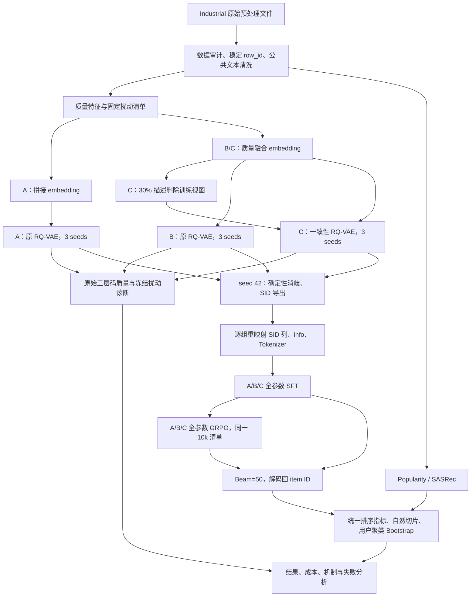

# 元数据质量感知与一致性约束的语义 ID 构建：面向生成式推荐的鲁棒表示研究

> **课程：**DSAA5020 — Foundations of Data Science & Analytics。  
> **设计版本：**v2，基于 [原设计](topic_minionerec.md) 调整研究问题与实验协议；原文件保留。  
> **核心设置：**Amazon Industrial、`Qwen/Qwen3-0.6B-Base`、全参数 SFT、全参数 GRPO。  
> **状态：**研究设计，尚未完成本文规定的训练与效果验证；审计数字是本地数据统计，所有模型结果均为待实验。  
> **主要贡献候选：**可解释的元数据质量融合与量化一致性约束；单卡可运行性作为工程条件，不作为主要研究创新。

## 1. 项目摘要与 v1 到 v2 的变化

MiniOneRec 将商品文本编码为连续向量，通过 Residual Quantized VAE（RQ-VAE）形成 Semantic ID（SID），再以语言模型执行下一商品预测、SID—文本对齐和推荐导向的 GRPO 后训练。本项目研究其中一个具体问题：**商品描述质量不一致，是否会通过语义量化影响下游推荐？**

v2 比较三种 SID 构建方式：A 为标题和描述直接拼接，B 为按质量权重融合标题与描述，C 在 B 的基础上加入干净与扰动视图的一致性约束。固定下游模型、样本与奖励协议，让 A/B/C 分别完成全参数 SFT 和全参数 GRPO，分析数据构建、量化稳定性与推荐效果的关系。

| 项目 | v1 | v2 |
|---|---|---|
| 研究重点 | 单卡缩小复现与 GRPO 增量 | 元数据质量、SID 稳定性与下游效果 |
| SID 正式方案 | 官方 SID 与一套重建 SID | A/B/C 三套自行构建的 SID |
| 官方资产 | 对照和环境验证 | 只作 sanity check，不增加正式 LLM 训练 |
| RQ-VAE 随机种子 | 单种子 | 42、43、44，三组共 9 次训练 |
| LLM 实验 | 两组 SFT、一组 GRPO | 三组 SFT、三组 GRPO，共 6 次训练 |
| 鲁棒性分析 | SID 质量审计 | 冻结量化器扰动诊断及自然缺失切片 |
| 统计协议 | 用户级 Bootstrap | 配对用户聚类 Bootstrap，保留同用户全部测试行 |

不进行模型规模、第二数据域、额外 SID 算法和 RL 奖励的大规模消融。研究对象仍为公开离线数据，不进行线上部署或业务收益推断。

## 2. 研究问题、假设与贡献边界

### 2.1 三个研究问题

| 问题 | 假设 | 直接对照 | 主要证据 |
|---|---|---|---|
| **RQ1：数据构建** | 字段分离与质量融合可能减轻描述缺失、重复和长度差异的影响 | B−A | SID 质量、整体 NDCG@10、缺失/非缺失切片 |
| **RQ2：训练方法** | 扰动一致性可能提高 SID 前缀与邻域稳定性，同时保留有效区分能力 | C−B | 前缀保持率、邻域保持率、利用率、熵和碰撞率 |
| **RQ3：下游有效性** | SID 构建差异可能在 SFT 和 GRPO 后仍影响推荐效果 | 各阶段 B−A、C−B、C−A | HR/NDCG、用户聚类置信区间和资源成本 |

### 2.2 可以与不可以得出的结论

- A→B 同时改变字段编码与融合规则，因此只能归因为**数据构建方案的整体变化**，不能独立证明质量权重本身有效。
- B→C 保持干净表示与基础损失不变，新增一致性项，因此是检验训练约束增量的主要对照。
- 一致性提高但推荐指标下降，是重要的负结果；不能只报告稳定性而忽略表示区分能力。
- 每组 RL−SFT 反映增加该段 GRPO 后训练的整体增量，没有等预算继续 SFT 对照，不能完全排除额外训练预算的作用。
- 元数据扰动只用于冻结量化器诊断，不在扰动目录下重新训练推荐模型，因此不声称已验证端到端推荐抗扰动能力。
- 自然缺失描述与其他商品属性可能相关，切片差异不等于描述缺失的因果效应。
- 相关的多视图、去噪、量化与正则化思想有既有研究基础；本项目不主张全球首次提出，贡献是明确规则、实现适配与受控实证分析。

### 2.3 与课程的联系

- **数据预处理：**审计描述缺失、文本重复、字段长度和商品映射，构造可解释质量特征。
- **神经网络与正则化：**比较重构/量化目标与附加一致性目标，观察稳定性和表示坍塌的权衡。
- **模型验证：**固定样本与训练预算、配对比较、用户聚类 Bootstrap、分组指标。
- **非 IID 数据与鲁棒性：**研究元数据扰动下表示变化；自然缺失切片用于识别异质表现，不直接命名为因果或分布偏移校正。
- **迁移学习与 LLM：**冻结文本编码器，并对 Qwen3-0.6B-Base 执行全参数推荐后训练。

## 3. 数据与环境协议

### 3.1 当前本地数据审计

以下为 2026-11-09 对本地官方预处理 Industrial 文件的只读统计，不是训练结果：

| 项目 | 数量 |
|---|---:|
| 商品元数据记录 | 3,686 |
| 原始描述为空的商品 | 229（约 6.21%） |
| `categories` 为空的商品 | 3,686；不用于构造类别标签 |

| 切分 | 行数 | 不同用户数 | 目标商品原始描述缺失的行数 |
|---|---:|---:|---:|
| Train | 36,259 | 7,034 | 1,919 |
| Validation | 4,532 | 2,011 | 417 |
| Test | 4,533 | 1,987 | 447 |

**一行是一个历史—目标预测样本，不等于一个用户。**同一用户可有多行；保持这些行不变，并以用户作为 Bootstrap 聚类单位。

重新执行审计时应记录输入 SHA-256、行数、历史长度、商品集合和统计脚本版本。若与上表不一致，先核对数据版本，不静默换数据或覆盖审计说明。

### 3.2 切分、商品目录与泄漏控制

- 使用本地 `MiniOneRec/data/Amazon/` 下 Industrial 的现有 train/valid/test 文件，保留原始顺序、用户、历史、目标及切分。
- 禁止重新划分、抽取最长序列、去重用户或运行会改变行集合的转换逻辑。新增 `row_id` 采用 `split + 原始从零行号`，原有字段不修改。
- 现有 CSV 没有逐交互时间戳，因此沿用官方切分与序列顺序，不虚构时间范围或声称重新验证了原始时间切分。
- 完整商品目录的静态标题和描述作为三组共同可用信息，允许用于编码和 RQ-VAE 训练；这是目录可见的 transductive 设置，不是新商品冷启动评测。
- 质量规则和训练视图不使用 validation/test 交互、目标频次或测试指标。
- “原始描述缺失”标签在公共文本清洗前，由原始描述去除首尾空白后是否为空确定，保存后不随方法或扰动变化。
- 不引入 LLM 生成描述、未来统计、外部类别或新的用户信息。

### 3.3 环境冻结

- 固定 MiniOneRec commit SHA、模型 revision，以及 Python、CUDA、PyTorch、Transformers、TRL、Accelerate 和 bitsandbytes 的实际版本。
- 文本编码器：`Qwen/Qwen3-Embedding-4B`，冻结、`eval()`、`no_grad()`；推荐模型：`Qwen/Qwen3-0.6B-Base`。
- 记录 A800 80GB、CPU、RAM、磁盘和驱动；单进程执行，不照搬八卡启动或八卡 ZeRO-2 配置。
- 模型本地路径与 revision 写入配置，不在结果中只记录一个可变的模型名。
- 量化器 seed 为 42/43/44；LLM、任务清单和 Bootstrap seed 为 42；训练扰动 seed 为 1701，诊断扰动 seed 为 2701。

## 4. A/B/C 方法定义

### 4.1 公共文本与编码函数

定义公共文本编码函数：

\[
E(s)=\operatorname{L2Norm}\left(\operatorname{MaskedMean}\left(f_{\mathrm{frozen}}(s)\right)\right).
\]

三组统一采用现有文本清洗函数，处理 HTML 和多余空白，不额外用标签生成文本。每次编码上限为 2,048 个 tokenizer token；padding 不参与 mean pooling；非有限或零范数 embedding 作为数据错误处理，不静默替换为零向量。

明确使用 **masked mean pooling**，以与本地 MiniOneRec 文本入口保持一致；不将本实验描述为比较文本编码器或 pooling 方法。字段分别编码会增加调用数和可用文本预算，这属于 A→B 数据构建变化的一部分，必须统计成本，不声称 A/B 编码 FLOPs 相等。

### 4.2 A：Concat

\[
x_i^A=E\left(\operatorname{join}(title_i,description_i)\right).
\]

直接拼接公共清洗后的标题和描述；空描述时只编码标题。若标题和描述都为空，以固定 `unknown item` 占位并计入审计，不删除商品。

A 是本项目的受控拼接基线，包含统一 L2 归一化和统一导出协议；它不等于逐字节复现官方预生成 embedding 或官方 SID。

### 4.3 B：Quality Fusion

分别计算：

\[
t_i=E(title_i),\qquad d_i=E(description_i).
\]

质量规则：

\[
q_i=\mathbf1[n_i>0]\min(n_i/32,1)(1-r_i),\qquad w_i=0.5q_i,
\]

\[
x_i^B=\operatorname{L2Norm}\left((1-w_i)t_i+w_id_i\right).
\]

- \(n_i\)：公共清洗后描述按空白分词的数量，质量统计时对词转小写。
- 若描述至少三个词，\(r_i=1-\lvert\mathrm{UniqueTrigrams}\rvert/(n_i-2)\)；否则取 0。
- \(q_i\in[0,1]\)，描述权重最多为 0.5，使标题始终保有至少一半的融合权重。
- 空描述时 \(w_i=0\)，不编码空字符串，直接返回标题表示。
- 不训练质量网络、不读取推荐标签，不额外调优 32 或 0.5；它们是预先固定的研究设计参数。
- 极短但有信息的描述可能被低估，这是需在失败案例中分析的规则局限，而不是预先认定的质量真值。

B 使用与 A 相同的 RQ-VAE 重构、量化目标。

### 4.4 C：Quality Fusion + Consistency

C 的干净输入与 B 完全相同。对有描述且至少两个词的商品，用 seed 1701 为每个 item 预生成一个扰动视图：随机删除约 30% 描述词，保持词序和标题不变；删除词数为 `min(n-1, max(1, floor(0.3*n)))`。清单缓存后在所有量化器种子中复用。

对扰动描述重新计算 \(n_i,r_i,q_i,w_i\)，得到 \(x_i^{aug}\)。缺失描述或无法形成不同非空视图的商品标记为 `valid_aug=False`，不计入一致性项分母。

令 \(z_q\) 为三个量化层输出相加后的向量，采用 straight-through 路径保留梯度：

\[
L_{base}=L_{reconstruction}+L_{quantization},
\]

\[
L_{consistency}=\frac{1}{\lvert V\rvert}\sum_{i\in V}
\left[1-\cos(z_{q,i}^{clean},z_{q,i}^{aug})\right],
\]

\[
L_C=L_{base}(x^{clean})+0.1L_{consistency}.
\]

- 重构、量化损失仅在干净视图计算；扰动分支只贡献一致性项，不额外重构干净输入，也不引入其他去噪损失。
- 两个量化表示均参与一致性梯度；数值计算的范数下界取 `1e-8`，无有效视图的 batch 一致性项为 0。
- B/C 的干净 embedding 缓存相同；一致性权重固定为 0.1，不根据测试结果选择。
- B→C 增加一次扰动前向与相关梯度计算，训练步数和干净样本顺序相同，但计算成本不相同。
- 一致性可能导致过度平滑或坍塌，因此必须联合报告碰撞、利用率、熵、邻域和推荐指标。

## 5. 系统 Pipeline 与接口产物



### 5.1 分阶段输入输出

| 阶段 | 输入 | 输出 | 必须保持的约束 |
|---|---|---|---|
| 审计 | 官方 CSV、item JSON | `data_audit.json`、`rows_manifest.jsonl`、文件哈希 | 不改变原始行集合 |
| 质量与扰动 | 公共清洗文本 | `quality_features.jsonl`、训练/诊断扰动清单 | 不访问推荐评测标签 |
| 编码 | 冻结 encoder 与文本清单 | 显式 item 顺序、干净/扰动数组、有效标记 | 跨缓存按 item ID 对齐 |
| 量化训练 | A/B/C 缓存 | 9 个最终 checkpoint、训练日志 | 固定配置，不挑最佳种子 |
| 原始码诊断 | 冻结量化器 | 三层 code、质量与稳定性表 | 使用消歧前语义码 |
| SID 导出 | seed 42 原始码 | `.index.json`、映射哈希、`info.txt` | 商品全覆盖、完整 SID 唯一 |
| 交互重映射 | 原始 CSV、各组映射 | 各组 train/valid/test CSV | 仅替换 SID 列 |
| 推荐训练 | 各组 CSV、公共任务清单 | 3 SFT + 3 GRPO checkpoint | 同文本、同来源样本、同奖励 |
| 评测 | item 预测、原目标 | 逐行指标、切片、Bootstrap、资源表 | 相同测试行和目录 |

### 5.2 缓存与量化器接口

以下是未来实现的接口契约，本次只写入设计文档：

```text
embedding_cache/
  item_ids.json          # 按显式、确定顺序排列的原始 item ID
  clean.npy              # [N, D]
  train_aug.npy          # [N, D]，A/B 可不使用
  valid_aug.npy          # [N] 布尔标记
  metadata.json          # encoder revision、pooling、归一化、清单和文件哈希
```

RQ-VAE 训练接口需要接受 `clean/aug/valid_aug`，并可选返回 `quantized_sum`；量化推理仍接受单个商品表示。输入维度读取缓存，不硬编码文本向量维度。

### 5.3 原始语义码与确定性碰撞消歧

- 每个商品保存最近邻量化得到的原始三个 code，使用 `use_sk=False`，诊断前不做碰撞重分配。
- 每个三层码桶内按原 item ID 的数值顺序排序；存在非整数 ID 时使用规范字符串顺序。附加第四个 `<d_j>` token，`j` 从 0 开始，单商品桶也附 `<d_0>`。
- 三组都使用四 token 完整 SID，防止 SID 长度变化成为额外变量。
- 初始三层使用 `<a_0..255>`、`<b_0..255>`、`<c_0..255>`；消歧词表取 A/B/C seed 42 所需后缀的共同并集。
- 三组以相同顺序注册同一完整新增词表、相同随机初始化，保证模型参数数量一致；各自保存与本组映射绑定的 tokenizer 和 manifest。合法前缀树只包含本组实际商品路径。
- 完整 SID 包括消歧后缀，必须在对齐、SFT、RL、约束解码与反向 item ID 映射中完整保留。

此导出方式是三组共同的项目协议，不声称与官方 SID 碰撞处理完全相同。表示诊断只使用前三层，避免消歧 token 干扰前缀稳定性。

### 5.4 交互重映射

从现有 CSV 的 `history_item_id` 与 `item_id` 重建对应 SID 列及 `info`，不重新生成用户序列。输出保留原始 `user_id`、标题字段、历史 item ID、目标 item ID、行序和切分，并附加共同 row_id。

若任何历史或目标商品缺少映射，立即失败；禁止跳过行。现有 `convert_dataset.py` 有只保留最长序列的处理选项，不能直接将其默认转换过程用于本项目。

## 6. 量化器训练与种子协议

| 参数 | A | B | C |
|---|---|---|---|
| 干净输入 | 拼接 embedding | 质量融合 embedding | 与 B 相同 |
| 一致性权重 | 0 | 0 | 0.1 |
| 语义量化层 | 3 | 3 | 3 |
| 每层 code 数 | 256 | 256 | 256 |
| 量化维度 | 32 | 32 | 32 |
| MLP 隐层 | `[2048,1024,512,256,128,64]` | 相同 | 相同 |
| 重构损失 | MSE | MSE | MSE，干净视图 |
| Quant loss weight | 1.0 | 1.0 | 1.0 |
| Commitment beta | 0.25 | 0.25 | 0.25 |
| K-means 初始化 | 开启，100 iterations | 相同 | 相同 |
| Sinkhorn epsilon | `[0,0,0]` | 相同 | 相同 |
| Optimizer / LR | AdamW / `1e-3` | 相同 | 相同 |
| Batch size | 20,480，实际为目录全量 | 相同 | 相同 |
| Epochs | 10,000 | 10,000 | 10,000 |
| Checkpoint | 最终 epoch | 最终 epoch | 最终 epoch |
| Seeds | 42、43、44 | 42、43、44 | 42、43、44 |

权重衰减 0、dropout 0、BN 关闭；沿用锁定仓库的 50 epoch warmup 与 constant scheduler。对相同 seed，保持模型初始化、干净数据顺序和公共配置一致；C 的扰动缓存不随量化器 seed 重抽。

共 9 次量化器训练。质量与稳定性报告三种子均值和样本标准差。下游一律使用 seed 42，不按验证或测试效果选择量化器种子，也不按最佳碰撞 checkpoint 替代最终 checkpoint。

## 7. Tokenizer、SFT 与 GRPO

### 7.1 Tokenizer 与共同 SFT 任务

- 采用同一 `Qwen/Qwen3-0.6B-Base` revision、共同扩充词表和 token 注册顺序。
- 验证每个 code 为一个原子 token、四 token SID round trip 正确、输入和输出 embedding 维度匹配。
- 保留 `SidSFTDataset`、`SidItemFeatDataset`、`FusionSeqRecDataset` 三类任务。
- 三组使用同一原始文本和任务来源清单，仅 SID 值不同；C 的扰动文本不注入 SFT 文本任务，以免数据构建和下游文本增强混在一起。
- 固定任务顺序、样本顺序与最大输入长度 512；prompt 和 padding 的 label 为 `-100`，目标 token 才计入交叉熵。
- SID→文本和文本→SID 是合法对齐任务；泄漏检查关注任务是否意外提前展示其目标，而不是把所有商品文本出现都视为泄漏。

### 7.2 全参数 SFT

| 参数 | 三组共同设置 |
|---|---|
| 模型 | `Qwen/Qwen3-0.6B-Base` |
| Seed | 42 |
| Precision / Optimizer | BF16 / AdamW |
| Trainable parameters | 100%，`freeze_LLM=False` |
| Effective batch | 1024 |
| Micro-batch / Accumulation | 16 / 64 |
| Learning rate | `3e-4` |
| Cutoff length | 512 |
| Max epochs | 10 |
| Early stopping | patience 3 次验证，沿用相同验证频率 |
| Checkpoint selection | 每组最低 validation SFT loss |

三组使用相同训练上限、验证与 early stopping 规则；若停止时点不同，记录实际步数与时间，不声称实际训练 token 或 FLOPs 严格相同。不得根据测试 NDCG 选择 checkpoint。

### 7.3 固定的 10,000 个 RL prompt

| 任务 | 数量 | 来源 |
|---|---:|---|
| SID 历史→下一 SID | 8,000 | Train 行 |
| 商品标题→SID | 1,000 | 公共商品目录 |
| 文本历史→下一 SID | 1,000 | Train 行 |
| 合计 | **10,000** | 不含 validation/test 交互 |

使用 seed 42 按确定排序后无放回抽样，各任务内不重复来源；跨任务可以共享同一交互。标题任务中同一标题对应多商品时，候选按规范 item ID 顺序保留一个，避免相同 prompt 对应冲突目标；若可用唯一标题不足 1,000，停止并记录，不用重复抽样悄悄补齐。

保存 `task_id/source_id/item_id` manifest。三组共享同一 manifest，映射为本组 SID 后再用相同顺序训练。按任务保留目标映射，检查相同 prompt 冲突，不能依赖可能覆盖多目标的 `history→target` 字典静默合并。

仅给 `rl.py` 一份 10k CSV 不会自动限制其多个子数据集的总量，因此未来入口必须显式消费这份全局任务 manifest；不能分别对三个子数据集各抽 10k。

### 7.4 全参数 GRPO

| 参数 | 三组共同设置 |
|---|---|
| 初始化 | 本组最佳 SFT checkpoint |
| Trainable parameters | 100%，不使用 PEFT/LoRA/QLoRA |
| RL prompt 数量 | 10,000 |
| Epochs | 2 |
| Generations / prompt | 16 |
| Per-device batch / Accumulation | 16 / 32 |
| Effective candidate sequences / update | 512，约 32 个 prompt 组 |
| Precision / Optimizer | BF16 / `paged_adamw_32bit` |
| Learning rate / KL beta | `1e-5` / `1e-3` |
| Max completion length | 128 |
| Reward | 原 correctness + rank-aware reward |
| Rollout | 原 constrained beam search，G=16 |
| Dynamic sampling / DAPO / GSPO | 关闭 |
| Reference model | 完整副本，不参与梯度更新 |
| `sync_ref_model` | 开启，实际同步间隔和混合系数写入锁定配置 |
| 正式 checkpoint | 完整 2 epochs 后的最终 checkpoint |

三组分别从本组 SFT 初始化，不共享参考权重；同步策略完全相同。参考模型“无梯度”不等于权重始终固定，周期同步仍可能改变权重。

不修改 reward 以适配质量规则，不增加前缀奖励或语义奖励。开发可用 G=4/8 和小样本，但这些结果不进入正式主表。策略更新前必须确认 rollout 分组、真实目标和 reward 映射正确；全零奖励组仍可能有 KL 梯度，不能称整个更新完全无梯度。

## 8. 主实验矩阵与受控比较

| ID | SID/表示 | 推荐训练 | 主要目的 |
|---|---|---|---|
| B0 | Item ID | Popularity | 简单推荐参照 |
| B1 | Item ID | SASRec | 传统序列推荐参照 |
| A-SFT | Concat RQ-VAE，seed 42 | 全参数 SFT | 受控生成式基线 |
| B-SFT | Quality Fusion RQ-VAE，seed 42 | 全参数 SFT | 数据构建增量 |
| C-SFT | B + Consistency RQ-VAE，seed 42 | 全参数 SFT | 一致性约束增量 |
| A-RL | A | A-SFT + 全参数 GRPO | 基线后训练 |
| B-RL | B | B-SFT + 全参数 GRPO | 数据构建效果是否延续 |
| C-RL | C | C-SFT + 全参数 GRPO | 完整方法后训练 |

总量为 **9 次 RQ-VAE + 3 次 SFT + 3 次 GRPO**，另有 Popularity 与 SASRec 基线；官方 checkpoint 只做 sanity check。

### 8.1 固定比较

| 比较 | 可回答的问题 | 不能单独证明的结论 |
|---|---|---|
| B-SFT−A-SFT、B-RL−A-RL | 数据构建整体方案是否影响结果 | 质量权重相对等权融合的独立优势 |
| C-SFT−B-SFT、C-RL−B-RL | 一致性约束的额外效果 | 所有数据集上普遍有效 |
| C-SFT−A-SFT、C-RL−A-RL | 完整方法相对受控基线的效果 | 相对原论文的跨模型优势 |
| A/B/C 的 RL−SFT | 本方案增加 GRPO 后训练的增量 | 排除额外训练时间的纯 RL 算法效应 |
| B0/B1 vs. A/B/C | 系统表现参照 | 在输入知识完全等价时生成式架构更优 |

Popularity 仅使用训练目标商品频次；SASRec 使用同一训练序列与验证集，参数、负采样和停止规则完整记录。生成式系统额外使用商品文本及预训练知识，因此传统基线比较属于系统比较。

## 9. 评测协议

### 9.1 SID 基础质量

每个方法、每个 seed 都报告：

| 指标 | 明确定义 |
|---|---|
| 原始碰撞率 | `1 - 唯一三层语义码数 / 商品数` |
| 碰撞涉及商品比例 | 所处三层码桶大小大于 1 的商品数 / 商品数 |
| 单层利用率 | 该层实际使用 code 数 / 256 |
| 单层分配熵 | `-sum(p_k * log(p_k)) / log(256)`，只累加非零项 |
| 最大原始桶 | 同一三层码对应的最大商品数 |
| 导出覆盖率 | 有完整 SID 的商品数 / 全部目录商品数 |
| 导出唯一率 | 唯一四 token 完整 SID 数 / 商品数 |
| 有效训练视图数 | `valid_aug=True` 的商品数 |

后缀唯一率 100% 是确定性消歧的正确性，不是量化器学得更好。若利用率、熵显著下降而保持率升高，结合碰撞和下游效果判断是否发生坍塌。

### 9.2 冻结量化器的扰动诊断

只对原始描述非空的同一商品集合进行三种诊断：

1. 删除 30% 描述词；
2. 删除 60% 描述词；
3. 删除全部描述，仅保留标题。

诊断清单用 seed 2701，与训练 seed 1701 分开。部分删除沿用保留至少一个词的规则；极短描述无法构成改变的部分删除视图时，从该扰动的有效分母中排除并报告数量。对相同商品，三组读取相同扰动文本；B/C 重新计算该视图质量权重。

固定每个训练完成的量化器，在 `eval()` 下分别编码干净和扰动输入，不更新参数、不重新聚类、不重编号 code：

\[
PPR@l=\frac{1}{N_{valid}}\sum_i
\mathbf1[c^{clean}_{i,1:l}=c^{perturb}_{i,1:l}],\quad l=1,2,3.
\]

前缀保持率只比较同一模型内部的 code。不同方法或 seed 的编号可能置换，不能直接逐 code 求相等率。

Top-10 邻域保持率定义为：

\[
NPR@10=\frac{1}{N_{valid}}\sum_i
\frac{|NN_{10}(z_i^{clean})\cap NN_{10}(z_i^{perturb})|}{10}.
\]

两次查询都使用**该运行的干净量化表示目录**作为固定候选参考，采用余弦相似度、排除 item 自身，距离相同按 item ID 打破平局。该指标衡量邻域稳定，不直接证明邻域语义正确；须与碰撞、利用率、熵和推荐效果联合分析。

对三种子报告均值和样本标准差。该三种子结果只覆盖量化器初始化随机性，不覆盖下游 LLM 或元数据抽样的全部不确定性。

### 9.3 推荐排序评测

- 开发 Beam=10；正式统一 Beam=50、返回 50 个候选、合法 SID 前缀约束、`length_penalty=0`。
- 正式评测显式强制 `do_sample=False`、`top_k=None`、`top_p=None`、`temperature=1.0`，不依赖 checkpoint 隐含生成配置。
- 所有候选解码回原始 item ID 后统一计分，使用相同完整商品目录和原测试行集合。
- 主评测**不屏蔽用户历史商品**，允许重复购买目标；Popularity/SASRec 同样不屏蔽历史。不能只对某个模型过滤已交互商品。
- 对重复候选计入诊断并以首次出现位置计算命中；非法候选保留其原排名占位，不通过删除后前移其他商品抬高指标。正式模型须先满足非法率为 0 的运行闸门。
- 固定输入目录与配置后统一执行最终测试；模型选择和开发仅访问 validation。

| 指标 | 口径 |
|---|---|
| **NDCG@10** | 主要效果指标，单目标命中按 `1/log2(rank+1)` 折扣 |
| HR@3/5/10 | 目标是否出现在前 K 个候选中 |
| NDCG@3/5 | 补充排序指标 |
| Coverage@10 | 前 10 推荐中唯一合法商品数 / 同一目录商品数 |
| 非法 SID 率 | 不映射到本组任何目录商品的候选数 / 全部候选数 |
| 重复候选率@K | 每行 `(K - 前K唯一候选数) / K`，再按行平均 |
| 资源成本 | 编码/RQ/SFT/RL/评测时间、峰值显存、checkpoint 大小与吞吐 |

主表按测试行计算均值，补充先按用户内行均值、再按用户平均的用户宏平均。两者清晰区分，不能都称“用户平均”。

### 9.4 自然缺失描述切片

按目标商品原始描述缺失/非缺失切分，报告每组测试行数、不同用户数、NDCG@10、HR@10 及配对差值区间。主数据下缺失描述目标有 447 行；切片指标可能较不稳定，应完整报告支持数。

目标缺失切片不等于其历史商品全部缺失；不将自然缺失组视为随机分配的实验组。若观察到 C 在缺失组表现更好，结论为“该自然切片的表现改善”，不直接推断因果机制。

### 9.5 配对用户聚类 Bootstrap

- 将同一测试用户的全部行视为一个簇，共 1,987 个用户簇。
- seed 42，有放回抽取 1,987 个用户簇，保留被抽中用户的全部行及重复次数，共 2,000 次。
- 对 B−A、C−B、C−A 及各组 RL−SFT 使用完全相同的重采样用户；按原主表的行加权规则重算差值。
- 报告 2.5% 与 97.5% 分位数的 95% 区间；自然切片按相同用户抽样后筛选目标行，若某轮无切片行则标为无效并报告有效次数。
- LLM 只有 seed 42，因此区间仅反映固定 checkpoint 下的用户采样不确定性，不能证明跨 LLM 初始化稳定。
- NDCG@10 是主指标，其余作辅助与诊断；不进行大量筛选后只展示显著指标。

### 9.6 结论判读

| 观察 | 允许的解释 |
|---|---|
| B>A | 字段分离与质量融合整体有帮助，尚未分离两者作用 |
| C>B，且语义码健康、稳定性和推荐均改善 | 支持一致性约束在该设置下有效 |
| 保持率提高但熵/利用率下降、推荐变差 | 可能过度平滑或坍塌，不能认定鲁棒性方法成功 |
| SID 更稳但推荐无变化 | 中间表示改善未转化为可测的推荐增量 |
| SFT 有差异、GRPO 后差异消失 | 后训练可能改变了 SID 方案差异的下游影响，需结合区间分析 |
| GRPO 后下降 | 如实报告，检查 reward、KL 与模型选择，不利用测试集反复重训 |

## 10. 命令模板与未来实现边界

以下命令用于明确未来接口，**本次未创建这些适配脚本，也未运行训练**。统一从 `project/MiniOneRec/` 根目录执行，相对路径均相对此目录。脚本名、参数和输出契约是待实现规格。

### 10.1 拟新增：公共数据与 embedding

```bash
# 拟新增入口：审计、稳定行标识、训练/RL/扰动清单
python scripts/v2_prepare.py \
  --data-root data/Amazon \
  --dataset Industrial_and_Scientific \
  --rl-counts 8000 1000 1000 \
  --seed 42 --train-view-seed 1701 --diagnostic-view-seed 2701 \
  --output-root outputs/v2

# 拟新增入口：A/B/C 的公共冻结编码与质量融合
python scripts/v2_build_embeddings.py \
  --manifest-root outputs/v2/manifests \
  --encoder Qwen/Qwen3-Embedding-4B \
  --pooling masked_mean --max-length 2048 \
  --quality-length 32 --description-max-weight 0.5 \
  --output-root outputs/v2/embeddings
```

### 10.2 拟新增：三种量化器与诊断

```bash
# 分别指定 A/B/C 与 42/43/44，合计九次；内部锁定对应一致性权重
python scripts/v2_train_rqvae.py \
  --method C --seed 42 \
  --embedding-root outputs/v2/embeddings \
  --epochs 10000 --batch-size 20480 --learning-rate 1e-3 \
  --num-emb-list 256 256 256 --consistency-weight 0.1 \
  --checkpoint-policy final \
  --output-root outputs/v2/rqvae

# 拟新增入口：冻结诊断全部 seed，随后只导出 seed 42 的下游映射
python scripts/v2_export_sid.py \
  --rqvae-root outputs/v2/rqvae \
  --diagnostic-manifest outputs/v2/manifests/diagnostic_views.jsonl \
  --downstream-seed 42 --collision-policy sorted_item_suffix \
  --output-root outputs/v2/sid
```

原 `rq/rqvae.py` 把 seed 固定在代码里，且没有一致性训练接口，因此不能把 `--seed` 或 `--consistency-weight` 假装成原脚本已经支持的参数。原导出器也有碰撞重分配逻辑，应由 v2 适配层显式提供原始码与确定性后缀协议。

### 10.3 既有 SFT 入口：现有参数模板

在完成映射、共同词表注册和任务数据适配后，A/B/C 分别执行：

```bash
python sft.py \
  --base_model Qwen/Qwen3-0.6B-Base \
  --train_file outputs/v2/data/C/train.csv \
  --eval_file outputs/v2/data/C/valid.csv \
  --sid_index_path outputs/v2/data/C/Industrial_and_Scientific.index.json \
  --item_meta_path outputs/v2/data/C/Industrial_and_Scientific.item.json \
  --category Industrial_and_Scientific \
  --batch_size 1024 --micro_batch_size 16 \
  --num_epochs 10 --learning_rate 3e-4 --cutoff_len 512 \
  --freeze_LLM False --train_from_scratch False --seed 42 \
  --output_dir outputs/v2/checkpoints/C-SFT
```

这段使用既有参数，但共同完整词表、四 token SID 与数据任务适配仍是前置实现要求；原入口未经适配不能直接保证满足全部实验约束。

### 10.4 拟新增 GRPO 入口：消费统一任务 manifest

```bash
accelerate launch --num_processes 1 scripts/v2_train_grpo.py \
  --model-path outputs/v2/checkpoints/C-SFT/final_checkpoint \
  --method C --data-root outputs/v2/data/C \
  --task-manifest outputs/v2/manifests/rl_tasks_10000.jsonl \
  --train-batch-size 16 --eval-batch-size 16 \
  --gradient-accumulation-steps 32 --num-generations 16 \
  --num-train-epochs 2 --learning-rate 1e-5 --beta 1e-3 \
  --max-completion-length 128 --sync-ref-model True \
  --seed 42 --output-dir outputs/v2/checkpoints/C-RL
```

该入口复用原 ReReTrainer 和 correctness + ranking reward；只适配统一采样、输入和配置记录，不新增 reward 方法。运行前固定 Accelerate 为单进程配置，避免继承用户机器上的八卡默认配置。

### 10.5 既有评测入口与拟新增统计入口

```bash
python evaluate.py \
  --base_model outputs/v2/checkpoints/C-RL/final_checkpoint \
  --info_file outputs/v2/data/C/info.txt \
  --category Industrial_and_Scientific \
  --test_data_path outputs/v2/data/C/test.csv \
  --result_json_data outputs/v2/predictions/C-RL.json \
  --batch_size 8 --num_beams 50 --max_new_tokens 16 \
  --length_penalty 0.0 --seed 42

# 拟新增入口：共同 item-ID 评测、自然切片及用户聚类 Bootstrap
python scripts/v2_evaluate.py \
  --prediction-root outputs/v2/predictions \
  --row-manifest outputs/v2/manifests/rows_manifest.jsonl \
  --quality-manifest outputs/v2/manifests/quality_features.jsonl \
  --bootstrap-unit user --bootstrap-repeats 2000 --seed 42 \
  --output-root outputs/v2/results
```

现有评测 CLI 没有显式传入 `do_sample/top_k/top_p` 的参数；未来实现必须在生成调用中强制第 9.3 节的设置，并保证结果保留或可恢复 row_id。四个原子 SID token 加 EOS 应在 16 个新 token 上限内结束，否则作为解码错误处理。逐组 `info` 必须来自该组映射，不能使用官方旧 SID 文件。

## 11. 结果表与资源记录模板

### 11.1 主结果表：按测试行计算

所有数值在训练完成前保持占位；原始数据统计不计作模型实验结果。

| ID | HR@3 | HR@5 | HR@10 | NDCG@3 | NDCG@5 | NDCG@10 | Coverage@10 | 非法率 |
|---|---|---|---|---|---|---|---|---|
| B0 | [待实验] | [待实验] | [待实验] | [待实验] | [待实验] | [待实验] | [待实验] | N/A |
| B1 | [待实验] | [待实验] | [待实验] | [待实验] | [待实验] | [待实验] | [待实验] | N/A |
| A-SFT | [待实验] | [待实验] | [待实验] | [待实验] | [待实验] | [待实验] | [待实验] | [待实验] |
| B-SFT | [待实验] | [待实验] | [待实验] | [待实验] | [待实验] | [待实验] | [待实验] | [待实验] |
| C-SFT | [待实验] | [待实验] | [待实验] | [待实验] | [待实验] | [待实验] | [待实验] | [待实验] |
| A-RL | [待实验] | [待实验] | [待实验] | [待实验] | [待实验] | [待实验] | [待实验] | [待实验] |
| B-RL | [待实验] | [待实验] | [待实验] | [待实验] | [待实验] | [待实验] | [待实验] | [待实验] |
| C-RL | [待实验] | [待实验] | [待实验] | [待实验] | [待实验] | [待实验] | [待实验] | [待实验] |

### 11.2 量化器与扰动表

每个指标保存逐 seed 原始值，主表填 `mean ± sample std`。PPR/NPR 分别按 30%、60%、全缺三种扰动展开，不合并为一个模糊的稳定性分数。

| 方法 | 原始碰撞率 | 利用率 L1/L2/L3 | 熵 L1/L2/L3 | PPR@1/2/3 | NPR@10 |
|---|---|---|---|---|---|
| A | [待实验] | [待实验] | [待实验] | [待实验] | [待实验] |
| B | [待实验] | [待实验] | [待实验] | [待实验] | [待实验] |
| C | [待实验] | [待实验] | [待实验] | [待实验] | [待实验] |

### 11.3 自然切片与配对差值表

| 阶段 | 比较 | 切片 | 测试行数/用户数 | ΔNDCG@10 | 配对聚类 95% CI | ΔHR@10 |
|---|---|---|---|---|---|---|
| SFT | B−A、C−B、C−A，各自展开 | 整体/缺失/非缺失，各自展开 | [待统计] | [待实验] | [待实验] | [待实验] |
| RL | B−A、C−B、C−A，各自展开 | 整体/缺失/非缺失，各自展开 | [待统计] | [待实验] | [待实验] | [待实验] |
| RL−SFT | A、B、C，各自展开 | 整体/缺失/非缺失，各自展开 | [待统计] | [待实验] | [待实验] | [待实验] |

### 11.4 成本表

| 阶段/实验 | 输入或有效视图数 | 实际更新步数 | GPU-hours | Wall time | 峰值显存 | 产物大小/吞吐 |
|---|---|---|---|---|---|---|
| A 编码 | [待记录] | N/A | [待记录] | [待记录] | [待记录] | [待记录] |
| B/C 公共编码与训练视图 | [待记录] | N/A | [待记录] | [待记录] | [待记录] | [待记录] |
| 诊断扰动编码 | [待记录] | N/A | [待记录] | [待记录] | [待记录] | [待记录] |
| A/B/C RQ，各 seed 展开 | [待记录] | [待记录] | [待记录] | [待记录] | [待记录] | [待记录] |
| A/B/C SFT，各自展开 | [待记录] | [待记录] | [待记录] | [待记录] | [待记录] | [待记录] |
| A/B/C RL，各自展开 | 10,000 prompt/组 | [待记录] | [待记录] | [待记录] | [待记录] | [待记录] |
| 各组 Beam=50 评测 | 4,533 行 | N/A | [待记录] | [待记录] | [待记录] | [待记录] |

公共缓存成本只计算一次，另注明各方法需要哪些缓存；不能把共享编码重复记为三次，也不能把 C 的额外视图和前向开销隐藏。单卡 GPU-hours 按实际 GPU 使用时间记录，wall time 另计数据与 CPU 开销。

## 12. 验收场景、运行闸门与失败处理

### 12.1 未来实现的必测场景

| 场景 | 预期行为 |
|---|---|
| 空描述 | B/C 精确回退标题，q=w=0，不编码空描述 |
| 大量重复描述 | 重复三元组比例升高、描述权重下降，数值有限 |
| 描述少于三个词 | r=0；无有效扰动时一致性不计分母 |
| item ID 与数组行不一致 | 显式映射正确；缺失/重复 ID 立即失败 |
| C 的一致性权重为 0 | 同一参数、输入和 seed 下总损失及梯度退化为 B |
| 扰动生成 | 标题、item ID、交互标签不变；训练与诊断清单可重现 |
| 有效视图为空 | consistency=0，无除零或 NaN |
| 原始语义码碰撞 | 诊断保留碰撞；四 token 导出后唯一且覆盖全部商品 |
| SID 重映射 | 行数、row_id、用户、历史与目标 item ID、标题、切分完全相同 |
| Tokenizer 与完整 SID | 每个 code 一 token，后缀不被截断，encode/decode 一致 |
| 多行用户 Bootstrap | 同用户全部行随用户簇一起抽取，可重复计入；方法配对 |
| 训练控制变量 | 三组原始文本、任务清单、共同词表和 reward 配置哈希一致 |

### 12.2 运行闸门

1. 数据审计与 item 映射通过，冻结文件哈希；
2. 质量规则和扰动清单可重现，公共缓存无非有限值；
3. RQ-VAE 梯度路径与 λ=0 退化检查通过；
4. 9 个量化器训练完成，原始码诊断与坍塌检查完整；
5. seed 42 映射覆盖全部商品、完整 SID 唯一、重映射不改变行；
6. 100 样本 SFT 可过拟合；四 token 合法解码通过；
7. rollout 分组与 reward 对齐正确，组内 reward 方差不是持续为零；
8. 正式评测前冻结 checkpoint、生成配置及统计代码，不使用测试效果调参。

### 12.3 OOM 与资源处理

- 文本编码降低 batch，不改变 encoder、pooling 或截断规则；记录实际 batch。
- SFT micro-batch 16→8→4→2→1，同步增加累积，保持有效 batch 1024；必要时启用 gradient checkpointing。
- 当前 ReReTrainer 的 batch 整除约束要求 G=16 时单卡 train batch 至少 16；不能只降低 batch 而声称保留原配置。
- GRPO 优先启用 gradient checkpointing、关闭训练中 Top-K 生成、清理无关模型副本；completion 上限只有在覆盖全部实际任务输出且三组同步调整时才能缩短。
- 最终评测 batch 8→4→2→1，保留 Beam=50。
- 全参数训练保持不变；若资源无法满足，明确记录未完成实验，不静默切换 LoRA 或删掉表现不佳的方法。

### 12.4 负结果与异常

- 非法 SID 非零：暂停正式比较，检查词表、四 token 路径、EOS、前缀树和 generation config。
- C 稳定性高但碰撞增加：检查表示坍塌，保留真实数据，不将结果裁剪成成功案例。
- 缺失切片支持较少：给出宽区间及数量，不用全目录 229 件商品替代实际测试支持数。
- 某方法 early stopping 较早：报告实际训练量；若因此讨论成本，需要同时呈现效果差异。
- GRPO 后指标下降：保留各方法最终 checkpoint 和相应结论，validation 诊断可以说明问题，不能用 test 选择重跑配置。

## 13. 相对里程碑与交付物

| 里程碑 | 工作 | 验收产物 |
|---|---|---|
| P1：数据与表示 | 审计、清单、公共清洗、质量规则与编码 | 数据/质量统计、manifest 哈希、A/B/C 缓存 |
| P2：量化器与诊断 | 9 次 RQ-VAE、原始码质量、冻结扰动诊断 | 三种子表、坍塌诊断、seed 42 导出映射 |
| P3：SFT | 共同词表和任务适配、A/B/C 全参数 SFT、传统基线 | 3 SFT checkpoint、基线、validation 记录 |
| P4：GRPO | 共享 10k manifest、A/B/C 全参数后训练 | 3 GRPO checkpoint、reward/KL/成本日志 |
| P5：评测与答辩 | Beam=50、自然切片、聚类 Bootstrap、机制与负结果 | 主表、诊断表、置信区间、资源表、报告与展示 |

不绑定已经过时的课程周次或固定日期。P4 不挤占 P2/P3 的正确性验证；若阶段未完成，应在报告中列明，而不是修改实验矩阵后继续声称全部完成。

未来代码与产物应保存：公共配置、各阶段入口、item 顺序、row/task/perturbation manifests、9 个量化器日志、6 次 LLM 训练配置、每次 checkpoint 选择记录、逐行 item-ID 预测、三种子诊断、聚类 Bootstrap 样本设置、资源账目和 README。checkpoint 可放在外部存储，仓库至少保留路径、哈希与下载/生成方法。

## 14. 答辩与成果表述

### 14.1 贡献候选

> 设计可解释的元数据质量融合和量化一致性约束，在统一推荐流程中分析商品数据质量、SID 稳定性与推荐效果之间的关系。

需要三条证据链：

1. **数据问题：**实际缺失、重复和长度统计说明动机；
2. **表示机制：**B−A、C−B 的质量与稳定性对照，同时检查坍塌；
3. **下游验证：**相同 SFT/GRPO 协议下的 item-ID 指标、自然切片和配对区间。

不是新增推荐架构、质量真值标注体系或新的 GRPO reward。全参数训练、RQ-VAE、SID 对齐、rank-aware reward 与 constrained beam search 均需归功于原项目及相关工作。

### 14.2 结果完成后可填的成果模板

- 构建质量感知字段融合与量化一致性训练，在 Industrial 上完成 A/B/C 三种 SID 方案，原始碰撞率及前缀保持率为 `[待实验]`。
- 对三种 SID 分别执行全参数 SFT 与 GRPO，在共同测试行上获得 NDCG@10 `[待实验]`，C−A 的配对用户聚类 95% 置信区间为 `[待实验]`。
- 审计缺失描述目标切片，报告支持数、效果与资源成本，分析表示稳定性是否转化为下游推荐收益 `[待实验]`。

不得预写效果提升、线上 CTR/CVR、生产部署、端到端抗扰动结论或全球首次创新。RQ-VAE 三种子稳定不等于 LLM 三种子稳定。

## 15. 参考资料

- [原项目设计 v1](topic_minionerec.md)
- [DSAA5020 Syllabus](../Syllabus.pdf)
- [MiniOneRec 官方仓库](https://github.com/AkaliKong/MiniOneRec)
- [MiniOneRec 技术报告](https://arxiv.org/abs/2510.24431)
- [MiniOneRec 官方数据与 checkpoint](https://huggingface.co/kkknight/MiniOneRec)
- [Qwen3-0.6B-Base](https://huggingface.co/Qwen/Qwen3-0.6B-Base)
- [Qwen3-Embedding-4B](https://huggingface.co/Qwen/Qwen3-Embedding-4B)

## 16. 最终验收清单

- [ ] 只使用 Industrial 和固定 Qwen3-0.6B-Base，无模型规模或额外数据域实验；
- [ ] A/B/C 方法、质量公式、训练/诊断扰动清单明确；
- [ ] RQ-VAE 完成 42/43/44 三种子共 9 次训练，固定最终 checkpoint；
- [ ] 下游仅用各方法量化器 seed 42，没有挑选最佳 seed；
- [ ] 三组均执行全参数 SFT 与全参数 GRPO，共 6 次 LLM 训练；
- [ ] 共同词表、原始文本、来源样本及 reward 协议一致；
- [ ] 所有四 token SID 覆盖完整、唯一、合法，重映射保持原始行与切分；
- [ ] 扰动诊断不更新模型，前缀指标不包含消歧后缀；
- [ ] 主表按测试行计分，补充用户宏平均，置信区间采用配对用户聚类 Bootstrap；
- [ ] 自然缺失切片报告实际支持数，不作因果或端到端抗扰动推断；
- [ ] 效果、坍塌、负结果和实际资源成本同时报告；
- [ ] 既有入口与拟新增参数明确区分，未把本设计写成已实现功能；
- [ ] 所有效果结果在执行前保持 `[待实验]`，原设计文档保持不变。
